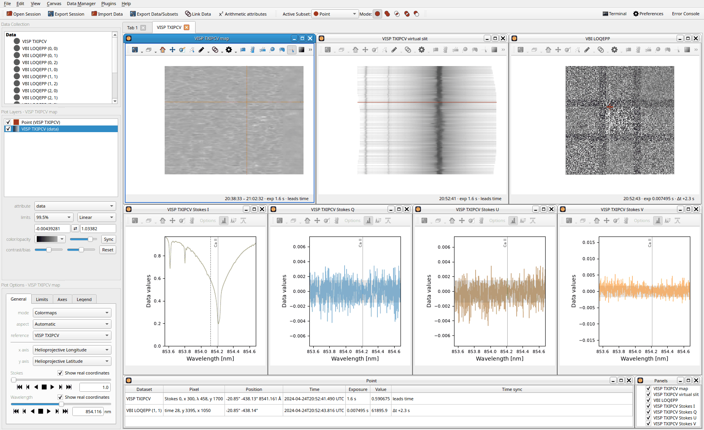
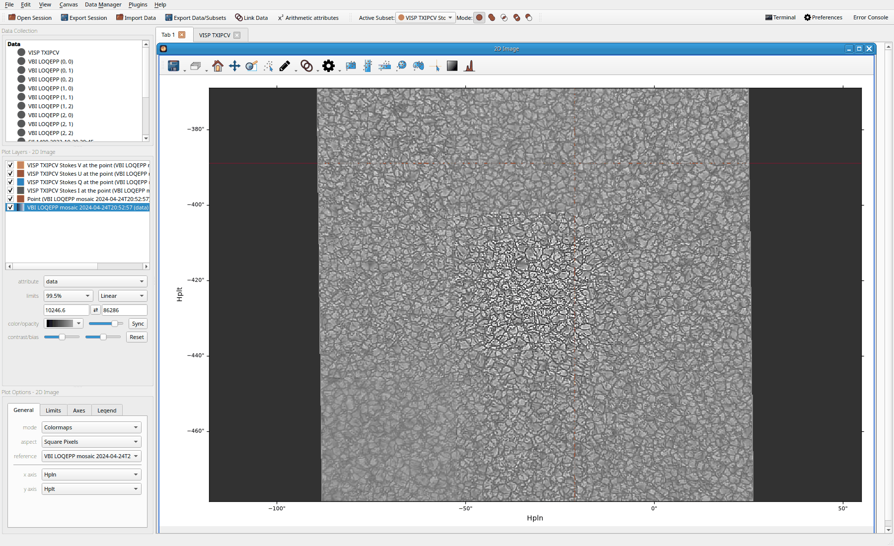

.. _glue_solar_users_guide_dkist_tutorial:

==============
DKIST tutorial
==============

Open a ViSP raster with the VBI mosaic observed with it, follow a point's Stokes spectra, link them
to IRIS data, stitch the mosaic into one image and save the session. The example is ViSP's Ca II
854.2 nm raster TXIPCV and VBI's 3 by 3 mosaic LOQEPP, observed together on 2024-04-24.

1. Download both from the DKIST Data Center with the `dkist
   <https://docs.dkist.nso.edu/projects/python-tools/en/stable/>`__ package. Each dataset is an ASDF
   file and its FITS files, which dkist transfers with Globus: run `Globus Connect Personal
   <https://www.globus.org/globus-connect-personal>`__, and log in to Globus when asked::

       from dkist.net import transfer_complete_datasets

       transfer_complete_datasets(["TXIPCV", "LOQEPP"], path="~/dkist")

   Each lands in its own folder, ``~/dkist/TXIPCV`` (4.3 GB) and ``~/dkist/LOQEPP`` (6.4 GB). To
   find other datasets, search the `archive <https://dkist.data.nso.edu/>`__, or sunpy's ``Fido`` as
   dkist's guide shows.
2. Start glue, choose "File → Open Data Set" and pick the two ASDF files,
   ``VISP_L1_20240424T203833_TXIPCV_metadata.asdf`` and
   ``VBI_L1_20240424T203852_LOQEPP_metadata.asdf``. They load in about a second as ``VISP TXIPCV``
   and the 9 tiles ``VBI LOQEPP (0, 0)`` to ``VBI LOQEPP (2, 2)``; the values stay in the files.
3. Press "Apply" in glue's "Link Suggestions": its 9 links join the raster and the other tiles to
   the center tile, ``VBI LOQEPP (1, 1)``.
4. Right-click ``VISP TXIPCV`` in the data collection and choose "Quicklook…". In about 10 s, as it
   opens the FITS files it reads and draws the tiles, the tab "VISP TXIPCV" shows the map, the
   virtual slit, the VBI mosaic at its frame nearest the point's step with the raster's slit and
   the point, and the spectra of Stokes I, Q, U and V at the point.
5. Click the map to move the point, about 3 s: the virtual slit, the VBI panel and the spectra
   follow. Each spectrum marks Ca II at 854.209 nm, in air as the dataset's ``WAVEREF`` says, and Q,
   U and V span ±5, ±5 and ±10 times their noise level, shaded about 0.

         VBI mosaic with the slit and the point, the Stokes I, Q, U and V spectra at the point, the
         Point window and the Panels list

The panels show each dataset on its own grid, south up and east to the right for these two. The
Point window gives the point in the raster and in the tile under it.

6. Click the VBI panel, on any tile, to move the point to the raster there: the step whose slit
   passes nearest and the slit pixel level with it. Press :kbd:`D` and :kbd:`F` to step the
   raster, the VBI panel showing the frame nearest each step. Choose "Lead the time" in the VBI
   panel's Coordinate menu, and they step its frames, the raster following.
7. With IRIS data of the same place and time loaded, choose "Link helioprojective coordinates" in
   the "Plugins" menu, a few seconds: a point on the IRIS data reaches the raster at the step whose
   slit passes nearest it, and a point on the raster reaches the IRIS data in the frame nearest its
   step's time.
8. Click "Tab 1", as the image opens in the current tab, right-click a VBI tile and choose
   "Mosaic…". In about 30 s the tiles, at the VBI panel's frame, are stitched into one image north
   up, ``VBI LOQEPP mosaic 2024-04-24T20:52:57``, 11275 by 11018 pixels, opened at 99.5 % limits
   and linked to the tiles and IRIS data, so the point shows on it.

         point's crosshair

9. Choose "File → Export Session". It refers to the ASDF and FITS files, but holds the mosaic's
   values, 632 MB: remove the mosaic first for a session under 1 MB, which glue-solar also keeps as
   the last session as glue quits. "File → Open Session" opens the quicklook again with its point
   and VBI panel in about 12 s.

For more on each step, see :ref:`DKIST datasets <glue_solar_users_guide_loading_dkist_datasets>`,
:ref:`Quicklook <glue_solar_users_guide_iris_quicklook>` and :ref:`Sessions
<glue_solar_users_guide_saving_sessions>`; for what takes time, :ref:`Known issues
<glue_solar_users_guide_known_issues>`.
