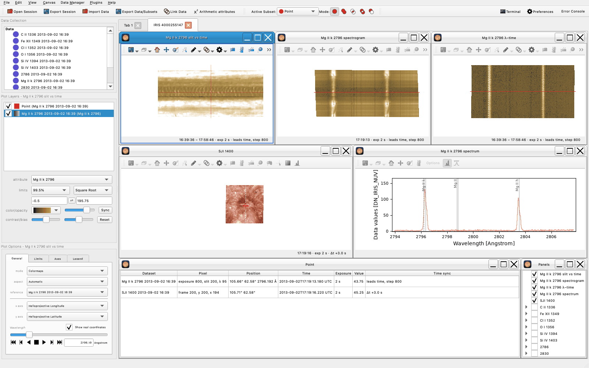

.. _glue_solar_users_guide_iris_quicklook:

=========
Quicklook
=========

The quicklook shows one observation as linked panels in a new tab, as CRISPEX does: the raster
map, its spectrogram, wavelength against time, each slit-jaw image and the spectrum at a point.
Move the point, or step in time or wavelength, and every panel follows.

         SJI 1400 image with the point's red cross, the spectrum at the point, the Point window and
         the Panels list

Opening a quicklook
-------------------

- In the observation browser ("Plugins → IRIS: browse observations…"), tick the observation or its
  windows and press "Load selected". "Open quicklook" is ticked at first.
- For data already loaded, choose "Quicklook…" in the right-click menu of a raster window, slit-jaw
  image or spectral cube in the data collection.
- From a terminal, run ``glue --startup=iris_quicklook raster.fits sji.fits``. Files given this way
  load one by one, so the quicklook shows the first scan; to stack scans, use the browser.
- In glue's Terminal, call ``glue_solar.quicklook.quicklook(application, datasets)``, with
  ``window="Si IV 1403"`` to choose the window.

The quicklook shows Mg II k 2796 when it is loaded, else the first window. An observation with only
AIA or SOT cubes has no quicklook: its first cube opens in an Image viewer.

The panels
----------

The raster opens as three panels, chosen from the observation:

.. list-table::
   :header-rows: 1

   * - Raster
     - Map
     - Spectrogram
     - Wavelength panel
   * - Scanning
     - step against slit
     - wavelength against slit, at the point's step
     - wavelength against step, at the point's slit
   * - Sit-and-stare
     - slit against time
     - wavelength against slit, at the point's exposure
     - wavelength against time, at the point's slit
   * - Stack of scans
     - step against slit, with a scan slider
     - wavelength against slit, at the point's scan and step
     - wavelength against scan, at the point's step and slit

Each slit-jaw channel gets a viewer titled with its channel, such as "SJI 1400". It draws the slit of
the frame shown as a dashed line and the point as a red cross. The spectrum panel shows the spectrum
at the point. Below the panels, the Point window gives the point's pixel, position, time, exposure,
value and time sync in each dataset, and the Panels list turns each panel on and off.

The map shows the wavelength nearest the window's reference wavelength. The panels use 99.5 % limits
and a stretch for their band: log in the FUV, square root about Mg II k and h, linear elsewhere in
the NUV. Change either in the layer options. The image panels open without axes; "Hide axes" in any
panel's View menu (the gear icon) shows or hides them on all of them. A sit-and-stare raster's time
axis is an index: exposures are evenly spaced whatever their cadence (see :ref:`Regridding on time
<glue_solar_users_guide_iris_regrid>`).

Picking a point
---------------

The point, the subset "Point", starts at the center of the map with the Pixel tool on. It is a
detector pixel, a step or exposure and a slit position, at every wavelength.

- **Click or drag on the map.** The spectrogram moves to the point's step, the wavelength panel to its
  slit position, and the spectrum panel shows its spectrum. Only the map draws the crosshair; the
  spectrogram and the wavelength panel mark its row with a thin red line.
- **Click the spectrogram or the wavelength panel.** The point moves there, and the map moves to the
  clicked wavelength.
- **Click a slit-jaw image.** The point moves to the raster pixel there, placed with the pointing of
  the frame shown: the nearest step and slit position, or on a sit-and-stare raster the exposure
  nearest the frame's time. A click off the raster leaves the point, and the viewer's "Frame time"
  says "outside raster FOV".
- **Follow the mouse.** Choose "Follow/lock" in a panel's toolbar: the point follows the mouse over
  that panel until a left click locks it. A right click or :kbd:`Esc` unlocks it.

Each image panel takes the Pixel tool as it becomes active, so the first click on any panel moves
the point. Undo (:kbd:`Ctrl+Z`, :kbd:`Cmd+Z` on macOS) takes a move back. "Clear point", in the
Coordinate menu's "Point" submenu (the link icon), removes the point until the next click, as does
removing the point's dataset from the data collection.

Each quicklook has its own point. Drag "Point" from the data collection onto another viewer to show
it there.

Stepping in time and wavelength
-------------------------------

Press :kbd:`D` and :kbd:`F` to step a frame, exposure, step or scan back and on, :kbd:`A` and
:kbd:`S` to step the map's wavelength, and :kbd:`Space` to play the time. The keys act on the panel
last clicked.

The panels follow one time. The raster is the time master: each slit-jaw viewer shows the frame
nearest the time of the point's exposure or step. Choose "Time master" in a slit-jaw viewer's
Coordinate menu to make it the master; the raster then moves to the exposure or scan nearest each of
its frames. An Image viewer of an aligned AIA cutout or SOT cube of the observation follows the time
too, and can be the master.

The "Frame time" line under each panel gives the time of the frame shown and its offset Δt from the
master. A dataset with nothing within half its time step of the master's time keeps its frame, is
grayed and says "NO MATCH".

- **Go to a time.** "Go to UTC…" in the Coordinate menu moves the time master to its frame nearest a
  typed time, such as ``2013-09-02T17:00:00``.
- **Loop a range.** "Loop…" in the Coordinate menu plays a range of the first slider, such as
  ``100 120`` or ``±10`` around the current index, every Nth index, or back and forth with "Bounce".
  To play a slit-jaw viewer with the raster following, make it the time master first.

Lines mark the wavelength and the time. The wavelength panel has a dashed white line at the map's
wavelength and a dotted one at the time master's time; the spectrum panel has a dashed gray line at
the map's wavelength. "Raster overlays" in the View menu draws each raster step's slit on the slit-jaw
images, and the time master's step on the maps. A zoom on the spectrum panel's wavelength axis
gives the wavelength panel the same range.

Regions
-------

Draw a region with glue's region tools, such as "Rectangular ROI" (:kbd:`R`), and the spectrum panel
adds its mean spectrum. A region on the map or a slit-jaw image also selects that place on the Sun
in the other data; one on the spectrogram or the wavelength panel selects on that
raster only. The Pixel tool still moves the point. To change a region, such as adding to it, pick it
as the toolbar's "Active Subset" first, and pick "Point" again after.

Light curves, rows and columns
------------------------------

The Coordinate menu's "Point" submenu plots the data through the point. Each plot follows the point.

- **"Light curve of this window"**, on the map of a sit-and-stare raster or a stack: the mean over the
  map's wavelength or band at the point, against exposure or scan, in a Profile viewer.
- **"Row at the point"** and **"Column at the point"**, on any raster map: the map's row along x, or
  its column along the slit, through the point.
- **"Light curves of the shown windows and SJI"**, on any Image viewer of IRIS, AIA or SOT data: the
  value at the point against time, for each window with exposures or scans and each slit-jaw channel
  the quicklook shows, in one Scatter viewer. Each curve is a new dataset, which "ECSV (with Time)" exports (see
  :ref:`Exporting derived data <glue_solar_users_guide_exporting_derived_data>`).

A Scatter viewer with time on its x axis, such as those light curves, highlights the time master's
exposure as the subset "Master exposure", and only there: on any other viewer its layer is removed at
the next step, since it would be redrawn at each one.

Comparing windows
-----------------

Tick several raster windows in the browser, or pass a list such as
``window=["C II 1336", "Si IV 1403", "Mg II k 2796"]``. The main window gets the map, spectrogram and
wavelength panel; choose it in the browser's "Main window" or pass ``main="Si IV 1403"``. The others
join the Panels list unticked. Tick one to add its spectrum panel in a row below, and on a
sit-and-stare raster or a stack its wavelength panel too. The point is the same pixel in every window.

"Show this window's panels", the triangle icon in another window's spectrum panel, makes that window
the main window. The point, the time and each kept panel's settings stay.

Untick a panel in the Panels list to hide it: it does no work until ticked again, when it catches up.

Blinking
--------

The Coordinate menu's "Blink" submenu alternates a viewer between two positions, such as the map at
Mg II k and at Si IV 1403, two wavelengths of one window, or two slit-jaw frames or channels.

1. Show the position to blink against. For another window, drag it onto the viewer, choose it as the
   reference data in the viewer's options and move its sliders.
2. Choose "Set blink partner here".
3. Go back to the position to show and choose "Blink".

The viewer flips every 0.5 s, or as set in "Blink interval", until "Blink" is chosen again. Nothing
else moves. Stop a blink before saving a session.

.. _glue_solar_users_guide_iris_spectrum_panel:

The spectrum panel
------------------

The spectrum panel is glue's 1D Profile viewer, with glue-solar's "IRIS lines" and "Velocity axis"
buttons (see :ref:`Viewer tools <glue_solar_users_guide_viewer_tools_and_windows>`). "IRIS lines"
marks the main IRIS lines at their NIST vacuum wavelengths. Its "Options" open glue's `profile tools
<http://docs.glueviz.org/en/stable/gui_guide/spectrum.html>`__:

- **Navigate.** Click the spectrum to move the map to the nearest wavelength.
- **Collapse.** Drag a wavelength range of two samples or more, pick a function such as Mean, and
  press "Collapse": the maps show the band until a slider moves. For a band that follows the slider,
  choose "Wavelength band…" in the map's View menu.
- **Fit.** Fit a line in a dragged range (below).

Keep the "x unit" at ``Angstrom``, the data's own, for Navigate and Collapse.

.. _glue_solar_users_guide_iris_velocity:

**Doppler velocity.** With a :ref:`rest wavelength <glue_solar_users_guide_iris_rest_wavelength>`,
the x unit lists ``km / s``: (λ / rest - 1) c, so Mg II k 2796.352 Å is at 0 km / s. "Velocity axis"
adds a top axis in km / s while the x unit is a length. Both follow "IRIS: set rest wavelength…". A
window without one, such as ``2832``, has neither.

**Rest wavelength from a measured line.** Level 2 wavelengths can be off by 5 to 10 km / s, and the
FUV and NUV drift apart. Measure the offset on a line nearly at rest: O I 1355.5977 Å for the FUV
windows (C II, Si IV, O I), or Ni I 2799.474 Å in the Mg II k 2796 window for the NUV.

1. Set the panel's function to "Mean" for the whole raster's signal.
2. On the "Fit" tab, pick "Gaussian + constant (IRIS)" and drag over the line: about 1355.4 to
   1355.8 Å for O I, or 2799.3 to 2799.65 Å for Ni I. Press "Fit".
3. Add the offset, the fitted center less the line's rest wavelength, to the rest wavelength of a
   line on the same detector, and set that with "IRIS: set rest wavelength…" on its window.

On OBSID 3824262996, O I fits at 1355.6172 Å (+4.30 km / s), so Si IV 1402.77 Å becomes
1402.789 Å. A saturated sample is only a lower bound, so the fit leaves a sample out where all the
pixels it combines are saturated (for a Point, where it is), says how many, and notes the wavelengths
whose mean includes saturated pixels, biased low (see :ref:`Missing and saturated samples
<glue_solar_users_guide_iris_saturation>`). To fit the same model to every spectrum of the window, see
:ref:`Line fit maps <glue_solar_users_guide_iris_line_fit_maps>`.

.. _glue_solar_users_guide_iris_fit_settings:

**Building the model.** "Settings" on the "Fit" tab lists the components of "Gaussian + constant
(IRIS)", at first a constant background and a Gaussian. Pick a Gaussian, a Lorentzian, or a constant,
linear or polynomial background (with its degree) and press "Add"; "Remove" drops one. Each parameter
has a start (blank: from the data), "Fixed", and a lower and an upper bound, either alone. A line's
parameter can be "Tied to" the same parameter of a line above it: an amplitude or a width is that
line's times the ratio (blank: the same), a center is that line's plus the separation, in the x unit;
a tie to a tied line follows it, its separations adding up and its ratios multiplying. For C II
1334.53 Å and its 1335.66 and 1335.71 Å blend:

1. Add two Gaussians and give ``mean_1`` the start 1334.53.
2. Tie ``mean_2`` to ``mean_1`` by 1.1305, and ``mean_3`` to ``mean_1`` by 1.1756.
3. Give each amplitude the lower bound 0, press "OK", drag over 1334.1 to 1336.2 Å and press "Fit".

The fit is drawn with each line on the background, dashed; "Clear" removes them. A line without a
start begins at one of the most prominent peaks, and each line at its peak among the samples nearer
its center than any other line's, so give a blend's lines starts or ties. The fit can be made with
the x unit in Å or ``km / s``, the starts, bounds and separations then in it. "Fit every spectrum"
then fits the model to every spectrum of the window (see :ref:`Line fit maps
<glue_solar_users_guide_iris_line_fit_maps>`).

**Mean spectrum.** "IRIS: subtract mean spectrum", in a raster window's right-click menu, adds
``<label> mean spectrum`` and ``<label> minus mean spectrum``. Set the "attribute" of "Point" in the
spectrum panel to the difference to see the point's spectrum less the mean. As a map's attribute, it
shows where each wavelength is brighter or fainter than the mean.

"IRIS: save profiles as ECSV…" in the panel's save menu writes the profiles shown to a table (see
:ref:`Saving the profiles <glue_solar_users_guide_iris_save_profiles>`).

Sessions
--------

A saved session opens each quicklook again with its point, time master, panel settings and panels
turned off, but not raster overlays, a blink or panels moved by hand. A light curve, row or column no
longer follows the point. See :ref:`Saving sessions <glue_solar_users_guide_saving_sessions>`.

Other spectral cubes
--------------------

A cube of another instrument, such as a FITS file glue's own reader opens, has a quicklook when it
has one wavelength axis and two axes of position, besides any time and Stokes axes. Choose
"Quicklook…" in its right-click menu. Its panels are those of the SST quicklook (see
:ref:`glue_solar_users_guide_loading_sst_cubes`) without the second map.

For CRISPEX users
-----------------

.. list-table::
   :header-rows: 1
   :widths: 40 60

   * - CRISPEX or iris_xcontrol
     - glue-solar
   * - ``crispex, raster, sjicube=sji``
     - Tick the observation in the browser, or run ``glue --startup=iris_quicklook raster.fits sji.fits``.
   * - Several ``sjicube`` files
     - Tick every slit-jaw channel; each gets its own viewer.
   * - iris_xcontrol's raster, sit-and-stare and multi-raster modes
     - Chosen from the observation (see `The panels`_).
   * - ``spcube``, the transposed cube
     - Not needed: the wavelength panel shows wavelength against step, exposure or scan.
   * - The cursor following the mouse, locked with a click
     - "Follow/lock" (see `Picking a point`_).
   * - Time and spectral sliders
     - :kbd:`D`, :kbd:`F`, :kbd:`A`, :kbd:`S` and :kbd:`Space`; "Loop…" sets the range to play.
   * - ``dt`` and uneven timing
     - "IRIS: regrid on time" (see :ref:`Regridding on time <glue_solar_users_guide_iris_regrid>`).
   * - Reference cube
     - Tick another window in the Panels list, or blink against it (see `Blinking`_).
   * - Average spectrum (``mnspec``)
     - Drag "Y range" (:kbd:`Y`) over scans or exposures on the wavelength panel: each spectrum panel
       adds their mean spectrum. For the whole raster, see "Mean spectrum" in `The spectrum panel`_.
   * - Spectral scaling of a window
     - Each spectrum panel has its own y range. For one scale, choose an arithmetic attribute such as
       ``{<label>} * 2`` as the attribute of "Point", or tick "normalize" in the panel's options.
   * - Doppler velocity axis
     - "Velocity axis", or ``km / s`` as the x unit (see `The spectrum panel`_).
   * - Timeslice along a drawn loop
     - "Path diagram" (:kbd:`L`; see :ref:`Viewer tools <glue_solar_users_guide_viewer_tools_and_windows>`).
   * - Save as PNG or movie
     - "IRIS: save frames or movie…" in a panel's save menu.
   * - Photospheric context
     - Tick a photospheric window, 2832 or 2814, or slit-jaw 2832. Aligned AIA 1700 and 1600 cutouts
       follow the time master as a slit-jaw viewer does.

In glue's Terminal, the mean spectrum over scans 40 to 59 of a stack ``raster`` is::

    cid = raster.main_components[0]
    average = raster.compute_statistic("mean", cid, axis=(0, 1, 2), view=(slice(40, 60),))
