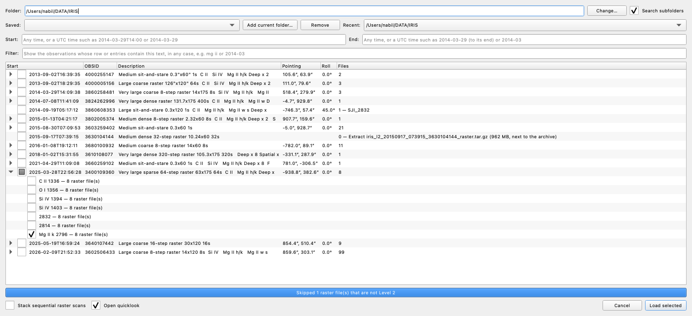
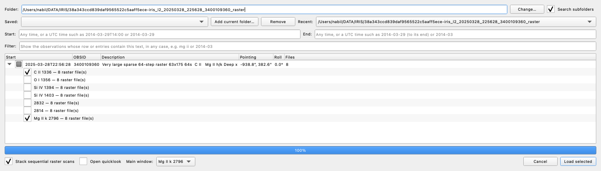
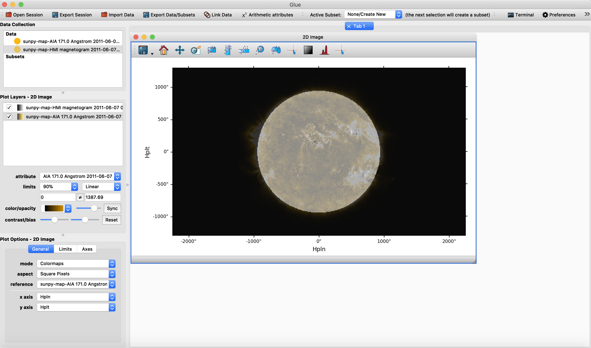

.. _glue_solar_users_guide_loading_data:

============
Loading data
============

.. _glue_solar_users_guide_loading_iris_level_2_raster_and_sji_files:

Browsing observations
---------------------

1. Choose "Browse observations…" in the "Plugins" menu.
2. Type a folder in "Folder" and press Return, or pick one with "Change…": a
   ``level2/yyyy/mm/dd/<obs>/`` tree, a download folder or a pooch cache. The browser lists each
   observation in it and its subfolders, one row per OBSID and start time, with its description,
   pointing (``XCEN``, ``YCEN``), roll (``SAT_ROT``) and number of files.
3. Expand an observation and tick what to load, or tick the observation for all of it:

   - a raster window, such as ``Mg II k 2796 — 8 raster file(s)``, with every scan;
   - a slit-jaw channel, such as ``SJI_1400`` or ``SJI_2796 (deconvolved)``;
   - an aligned AIA cutout, such as ``AIA 1700``, or Hinode/SOT cube, such as ``SOT G band 4305``
     or ``SOT 6302A B_LOS`` (`ITN 32 <https://iris.lmsal.com/itn32/>`__);
   - an SST cube (see `SST CRISP and CHROMIS cubes`_);
   - ``Extract <archive> …``, for a download still packed, such as ``*_raster.tar.gz`` or
     ``*_SDO.tar.gz``: it is unpacked next to the archive, and the list then shows what it held.

4. Press "Load selected", or Return. A double-click on an entry loads it alone.

With "Open quicklook" ticked, each observation opens in a quicklook (see :ref:`Quicklook
<glue_solar_users_guide_iris_quicklook>`) with the map, spectrogram and wavelength panel of the
window in "Main window", which shows once two or more windows are ticked, Mg II k 2796 unless
changed. Unticked, the first slit-jaw image or AIA cutout opens in an Image viewer.

"Stop" ends a search or a load with what has been read in full; :kbd:`Esc` drops it. If an entry
fails to load, the progress bar names the file and the error.

To narrow the list:

- **Filter** shows the observations whose row or entries hold the text, in any case: ``mg ii``,
  ``2013-09-02`` or an OBSID. "Load selected" loads every tick, shown or not.
- **Start** and **End** take UTC times, such as ``2013-09-02T16:00``, ``2013-09-02`` or ``2013-09``:
  press Return to list the observations running between them. An "End" without seconds runs to the
  end of the minute, hour, day, month or year it names.
- **Recent** lists the last 10 searches, and **Saved** the folders saved with "Add current folder…".

**Stacking scans.** Tick "Stack sequential raster scans" to load each window's scans as one cube,
indexed by scan, raster step, slit pixel and wavelength, without resampling. The scan slider picks a
scan, and each scan keeps its own coordinates and times.

What a dataset holds
--------------------

Each dataset is labeled by its window or channel and its observation's start, to the minute, and a
raster window of an observation of several rasters by its scan: ``Si IV 1403 2013-09-02 16:39``,
``Si IV 1403 2013-09-02 18:29 scan 0``, ``Mg II k 2796 2025-03-28 22:56 stack`` or
``SJI 1400 2013-09-02 16:39``. Data made from one are labeled after it, such as
``… stack moments 2796.35``. Each raster window, stack, slit-jaw image and AIA cutout has these
attributes, ``<window>`` being its window or channel, such as ``Si IV 1403``:

- ``<window>``, the data, in DN, with fill values as NaN;
- ``Time``, the UTC time of each raster step, exposure or frame;
- ``Exposure time``, in s;
- ``<window> DN / s``, the data over the exposure time;
- ``<window> mask``, 1 where the data are missing or, in a raster window or slit-jaw image,
  saturated (see `Missing and saturated samples`_).

SOT cubes are in the unit of their ``BUNIT``, such as DN or G. AIA cutouts and SOT cubes get no
quicklook panel, but an Image viewer of one follows its observation's time. Each dataset opens in
sunpy's colormap of its channel, and an Image viewer's colormap menu lists every sunpy colormap.

irispy reverses the step axis of a raster with a negative step (``STEPS_AV`` below -0.01), so
``Time`` runs backwards along it.

Data are read from their files as they are viewed. Don't overwrite, move or unplug a file while it
is loaded: glue can crash.

Opening files
-------------

"File → Open Data Set" or "Import Data" opens single files, as does ``glue file.fits`` from a
terminal. With the file type "Auto":

- an IRIS slit-jaw image, aligned AIA cutout or SOT cube loads as one cube;
- an IRIS raster file loads a dataset per window, labeled with its raster number (``… scan 3``) if
  its observation has several;
- an SST CRISP or CHROMIS cube loads as one cube;
- a DKIST dataset's ASDF file loads as one dataset, a VBI or DL-NIRSP mosaic as one per tile.

For AIA, HMI and other solar images, pick the file type "sunpy Map". Files loaded one by one cannot
be stacked: use the browser for observations of many scans.

.. _glue_solar_users_guide_loading_sst_cubes:

SST CRISP and CHROMIS cubes
---------------------------

Open an SST archive cube, a SOLARNET FITS file from SSTRED (``nb_8542_…_im.fits``), with "File →
Open Data Set", or point the observation browser at a folder of the archive: its cubes list as one
observation, the instrument as its OBSID.

- The axes are scan, Stokes, tuning, y and x, without Stokes for a cube of intensities such as
  CHROMIS's.
- Each scan has its own pointing, which moves in a mosaic. The wavelengths are the nominal ones, in
  nm, and ``Time`` gives each tuning of each scan.
- ``Cavity error`` is the shift of each pixel's wavelength from the nominal one, in nm: add the
  arithmetic attribute ``{Wavelength} + {Cavity error}`` for the corrected wavelength.
- A Profile viewer's "Main lines" mark the ground-based lines (see `DKIST datasets`_) in air, as
  SSTRED's wavelengths are, such as Fe I 630.25 nm; "Lines in this range…" lists them, and they
  give the cube's :ref:`rest wavelength <glue_solar_users_guide_iris_rest_wavelength>`.

The SST quicklook opens from the browser, or with "Quicklook…" in the cube's right-click menu, in a
tab named after its line, such as "SST Ca II 8542". Its panels are in three rows:

- the map at the line core, the tuning nearest the cube's line; a second map at the first tuning,
  the blue wing; and the virtual slit, wavelength against y at the point's x;
- the spectra at the point of Stokes I, Q, U and V;
- wavelength against scan at the point, and the light curve at the point, against "Scan Time", the
  scans' time in s since the cube's ``DATEREF``, which also names the scan slider.

Both maps open zoomed to the field, without a mosaic's NaN border, and stay on it as panels turn on
or off until you pan or zoom. The second map opens with "Per-frame limits" on, as the whole cube's
limits wash the brighter wing out.

The point, clicks and keys work as in the IRIS quicklook, and the scan and Stokes sliders of either
map move the other panels. Cubes with overlapping scan times, such as the CRISP and CHROMIS cubes of
one morning, share one time. Once linked (see `Linking`_), a point on one cube moves the points of
the other cubes that share its time to the same place on the Sun, each at its own scan and tuning,
while Coordinate → Point → "Link points across cubes" is on, as it is at first; IRIS data's points
stay. Another such cube's quicklook opens with its point at that place, or at its map's center if
the place is off the cube.

Q, U and V show scaled with their noise level: their maps' limits are ±5 times it for Q and U and
±10 times for V, whose signal is the stronger, and their spectra span at least as much, with the
noise level shaded about 0. The noise level is the parameter's standard deviation at the continuum,
the first or last tuning, whichever is farther from the line core, estimated from the median
absolute deviation of a sample of rows and columns from up to 16 scans. View → "Per-frame limits"
gives each frame its own limits instead; on the second map it changes I's only.

For a spectrum in a Profile viewer, draw a region on the cube: a cube's own profile reads the whole
file, so glue-solar adds the cube hidden. Open maps before SST cubes, and cubes without Stokes before
those with: glue's autolinker otherwise reports an error, although the data load. The IRIS–SST
Level 3 files made for CRISPEX (``iris_l3_…_im.fits``) open with glue's "FITS file" reader, without
these coordinates.

.. _glue_solar_users_guide_loading_dkist_datasets:

DKIST datasets
--------------

Open a DKIST Level 1 dataset's ASDF file (``…_metadata.asdf``, as ``dkist`` downloads it) with
"File → Open Data Set". It loads as one dataset, labeled by instrument and dataset ID, such as
``VISP BKPLX``, and a VBI or DL-NIRSP mosaic as one dataset per tile, such as ``VBI YCDRFH (1, 1)``.
The values stay in the FITS files next to the ASDF file: a view reads only the parts of the files it
shows. The first read of each file opens it, about 5 ms as astropy reads its headers: a ViSP map at
a Stokes parameter not yet shown takes up to 3 s, its later moves about 0.5 s.

- Each axis has one world coordinate, as glue shows them: a slit raster's step axis has its
  longitude, or its time if the pointing moves less than a pixel along the slit (sit-and-stare).
  Longitudes are from -180° to 180°.
- A frame whose FITS file is missing reads as NaN, and glue's Error Console says how many files
  are there; one whose file is part-written, as Globus writes it, or corrupt reads as NaN too, the
  Error Console naming the file, until the file is whole.
- Color limits come from up to 16 whole frames; the tiles of a mosaic share theirs. NaN
  pixels are transparent, as IRIS data's, so a mosaic's tiles in one Image viewer don't hide each
  other.
- Each frame's time and exposure, from its FITS headers (``DATE-AVG`` and ``XPOSURE``), show in the
  "Frame time" line, the cursor readout and the quicklook's Point window.
- A point on a dataset of Stokes parameters, repeats or Cryo-NIRSP measurements is taken at
  the Image viewer's Stokes parameter, repeat and measurement, and moves with their sliders: its
  Profile runs along the wavelength, raster step or time alone.
- "Quicklook…" opens a ViSP or Cryo-NIRSP spectrograph dataset as any spectral cube: its map,
  virtual slit and spectra. The map is drawn as IRIS's, the steps across and the slit up, and the
  virtual slit is wavelength against the slit. A raster's repeats, or Cryo-NIRSP's measurements
  at each step, have a slider, as Stokes does. Of a full-Stokes dataset, Q, U and V show scaled
  with their noise level, as an SST cube's, at the quieter end of the wavelengths, sampled from 4
  frames.
- A Profile viewer's "Main lines" mark the lines ground-based telescopes observe, such as Ca II
  854.2 nm, Fe XIII 1074.7 nm and He I 1083.0 nm, at NIST's wavelengths in air or vacuum as the
  dataset's ``WAVEREF`` says, DKIST's being in air; "Lines in this range…" lists them, and they
  give the dataset's :ref:`rest wavelength <glue_solar_users_guide_iris_rest_wavelength>`.
- With the context imager observed with it loaded (VBI with ViSP, the context imager with
  Cryo-NIRSP's spectrograph: one observing program execution, at times that overlap), the
  quicklook shows its frame after the virtual slit, every tile of a VBI mosaic once glue's
  suggested links are accepted, as IRIS's slit-jaw images: the raster's slit at the point's step
  and the point are drawn on it, a click on it, on any tile of a mosaic, moves the point
  to the raster there, and its frame follows the raster's step in time; with "Lead the time" on
  it, the raster's step in the repeat shown follows its frame. A Cryo-NIRSP context image takes
  the spectrograph's Stokes parameter and measurement.
- glue offers to link DKIST datasets as they load, pixel to pixel by their coordinates, time
  included: accept, and a point on one reaches the others, and one draws over another in an Image
  viewer. A mosaic's tiles link to its center tile, and other datasets to that tile; remove the
  center tile, and the tiles link to the first one left. Datasets observed together link though
  they start apart, and those taken at different times don't. A point reaches a raster's step
  taken at its time, as dkist's coordinates place it; a point or frame outside another dataset's
  times reaches nothing there, so a mosaic's tiles that start later draw blank at the first frame.
  With "Link points across cubes" on (see `SST CRISP and CHROMIS cubes`_), a point in a raster's
  quicklook moves another linked raster's quicklook point to the step whose slit passes nearest it,
  at that raster's repeat or measurement.
- "Link helioprojective coordinates" links them to IRIS data by position, and by time at the
  nearest frames. A point on IRIS data reaches a ViSP or Cryo-NIRSP spectrograph raster at the
  step whose slit passes nearest it, at the repeat or measurement nearest its time, or on a
  sit-and-stare raster the step nearest its time, and at the slit pixel level with it. A point more
  than half a step past a scanning raster's first or last step, or half a slit pixel beside the slit
  of a raster of one step, doesn't reach it. A point on the
  raster reaches IRIS data at its place, in the frame nearest its step's time, and IRIS images
  draw over the raster's map.
- "Mosaic…" on a tile of a VBI or DL-NIRSP mosaic adds its tiles stitched into one image by
  reproject, at the frame, or Stokes parameter, repeat and wavelength, of the first Image viewer of
  a tile, and opens it in an Image viewer at 99.5 % limits, labeled by that wavelength, Stokes
  parameter and time,
  the tiles' mean, which its metadata hold too, such as ``VBI LOQEPP mosaic 2024-04-24T20:43:45``.
  Its grid is north up at the tiles' finest pixel, their mean where they overlap and NaN where none
  is, and only that frame of each tile is read: LOQEPP's 9 tiles take about 30 s. A session saves
  its values, 0.66 GB for LOQEPP's. It links to the tiles by position and their time there, and to
  IRIS data as "Link helioprojective coordinates" does: a point on it reaches a tile's pixel at that
  frame or repeat, on DL-NIRSP at every wavelength and Stokes parameter.
- "DKIST footprints…" in the View menu of an Image viewer of a helioprojective image, such as an IRIS
  slit-jaw image, an AIA map, an SST cube or another DKIST dataset's frame, draws the outline of each
  loaded DKIST dataset ticked, labeled, and a spectrograph raster's slit at the image's time, unless
  more than half its cadence from it (a step's on ViSP, a measurement's on Cryo-NIRSP), its other
  steps faint. They come from the ASDF file alone, so a dataset loaded without its FITS files shows
  what overlaps before you download them, and are placed by value, as
  "Link helioprojective coordinates" places data. They follow the image's frame; untick a dataset to
  clear its outline.
- "Frame quality…" on a dataset, or a tile of a mosaic, adds ``<label> frame quality``, a row per
  FITS file from the ASDF file's headers, no FITS file read: the seeing ``ATMOS_R0`` (m), AO lock
  ``AO_LOCK`` (1 while locked), exposure ``XPOSURE`` (ms), light level ``LIGHTLVL`` (adu),
  elevation ``ELEV_ANG`` (deg) and ``Time``, linked to the dataset by time. A Profile viewer plots
  it against the time in s since the first frame: the seeing, else the light level, the frames whose
  AO was not locked shaded; pick another as the layer's attribute. A red line
  marks the frame an Image viewer of the dataset, or of a tile of its mosaic, shows, and follows its
  time slider; a click on the curves moves the sliders to the frame nearest in time, at their own
  Stokes parameter. A session keeps the curves; "Frame quality…" again opens them in a new Profile
  viewer with the line and clicks.
- "Download these frames…" fetches some of a dataset's FITS files by Globus, of a mosaic's loaded
  tiles on a tile, into the ASDF file's folder: those at the Stokes parameter, repeat and
  measurement of its first Image viewer, or all of them where ticked, over the steps or frames
  typed, all at first. Its dialog says how many files are missing, not counting those already on
  their way, their size, from the dataset's mean file size, and their times; the transfer then
  starts in the background, of the FITS files alone, not the ASDF file, browse movie and quality
  report dkist's ``download`` adds. Their frames fill in as the files arrive, glue's status bar
  counting them, and the color limits are taken again; once all are there, the Error Console says
  how many of the dataset's files are still missing, if any. It needs Globus Connect Personal set
  up and running, and a Globus login, which dkist asks for in the web browser the first time.
- A session keeps them, their viewers and links, and reads their coordinates again from the ASDF
  files (see :ref:`Sessions <glue_solar_users_guide_saving_sessions>`).

.. _glue_solar_users_guide_loading_aia_and_hmi_files:

AIA and HMI maps
----------------

1. Choose "File → Open Data Set", select the files, and pick "sunpy Map" as the file type. For AIA
   cutouts aligned to IRIS (``aia_l2_*.fits``), leave "Auto".
2. Drag a map onto an Image viewer.
3. Drag a second map onto the same viewer. glue links maps by their coordinates, asking the first
   time, and draws the second rotated and aligned onto the first.

.. _glue_solar_users_guide_iris_linking:

Linking
-------

The browser, a quicklook and the analyses link the helioprojective coordinates of the IRIS data they
load or make, so a region drawn on one selects the same place on the Sun in the others. AIA cutouts,
SOT cubes, maps, SST cubes and files opened with "File → Open Data Set" link only on request: choose
"Link helioprojective coordinates" in the "Plugins" menu once they are loaded, and again after
loading more. With no IRIS data loaded, they link to the
first of them, so SST cubes link to each other.

- A region on a raster map or a map selects, in each slit-jaw frame, the pixels inside it at that
  frame's own pointing.
- A region on a slit-jaw image carries over only in a quicklook, placed with the pointing of the
  frame shown.
- A region on a linked SST cube selects the IRIS pixels, and another SST cube's, in the cube's scan
  nearest each frame's or scan's time; it selects nothing on a map, which has no time.
- Draw regions on a quicklook's panels: glue's own selection, from a raster in another Image viewer,
  is slow to show on a slit-jaw image.

The links don't allow for the Sun's rotation between a map and the IRIS data. Correct the IRIS
pointing with :ref:`"IRIS: shift pointing…" <glue_solar_users_guide_iris_pointing>`.

.. _glue_solar_users_guide_iris_fits_header:

Seeing the FITS header
----------------------

Select a dataset in the data collection and press :kbd:`Ctrl+I` (:kbd:`Cmd+I` on macOS), or choose
"View metadata/header" in its right-click menu: a raster window's or slit-jaw image's primary
header, then irispy's values per raster step or frame. A stack shows its first scan's. The window
shows only the last ``HISTORY`` line; in glue's terminal, ``raster.meta.fits_header`` gives them all,
and ``astropy.io.fits.getheader(path, n)`` the header of window ``n``.

.. _glue_solar_users_guide_iris_saturation:

Missing and saturated samples
-----------------------------

Level 2 clips every sample to -199 to 16182 DN, so a sample saturated in Level 1 is stored at
16182 DN. glue-solar, as irispy, keeps raster and slit-jaw samples at that ceiling at their value, so
images, spectra and light curves show them, and marks them saturated in ``<window> mask``. Level 2
cannot tell a saturated sample from one merely that bright, and its ``NSATPIX`` and ``TSATPXn`` are
always 0: ignore them. The analyses blank a pixel where a sample they take is saturated, and the mean
spectrum leaves such samples out. The IRIS fits leave a sample out where all the pixels it combines
are saturated (for a Point, where it is), and note the wavelengths whose mean includes saturated
pixels. UV burst detection takes saturated samples at their value, as IDL does.

To show missing or saturated samples as a subset, select the dataset itself in the data collection,
not "Point", and in the "Data Manager" menu:

- **Missing or saturated:** choose "Create faceted subsets", pick ``<window> mask``, and set the range
  from 0 to 1 and 2 subsets. The second subset holds the masked samples.
- **Saturated:** choose "Add/edit arithmetic attributes" and add ``saturated`` as
  ``({<window>} >= 16182) * 1``, then "Create faceted subsets" of it from 1 to 1, with 1 subset.

Select "Point" again before moving a quicklook's point.
