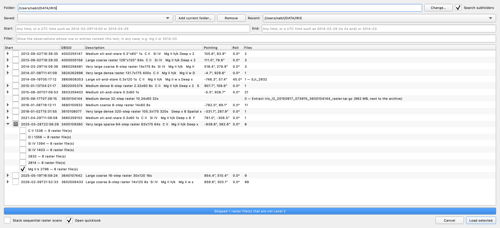
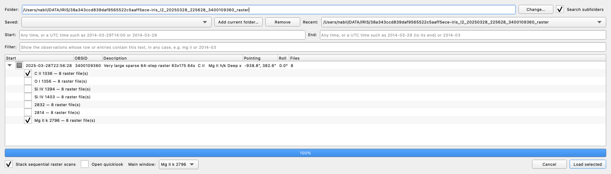
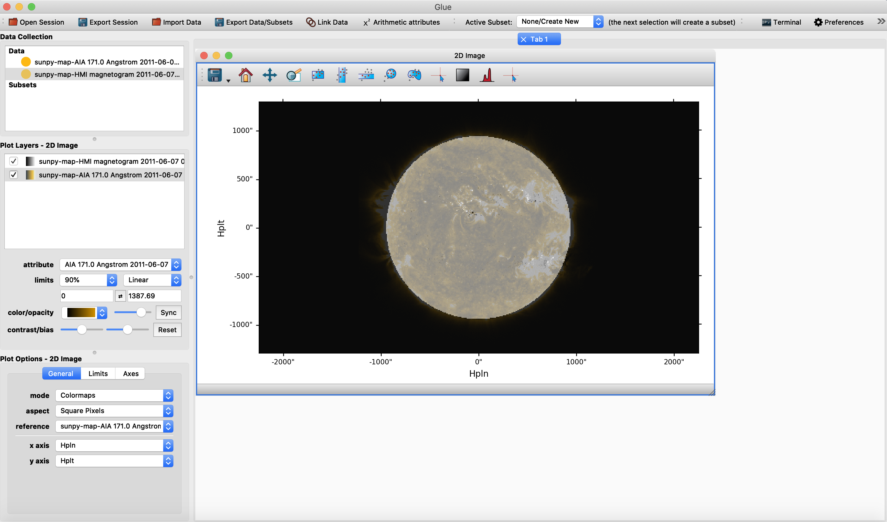

.. _glue_solar_users_guide_loading_data:

============
Loading data
============

.. _glue_solar_users_guide_loading_iris_level_2_raster_and_sji_files:

Browsing observations
---------------------

1. Choose "Browse observations…" in the "Plugins" menu.
2. Pick a folder in the dialog that opens: a ``level2/yyyy/mm/dd/<obs>/`` tree, a download folder or
   a pooch cache. The browser lists each observation in it and its subfolders, one row per OBSID and
   start time, with its description, pointing (``XCEN``, ``YCEN``), roll (``SAT_ROT``) and number of
   files. For another folder, type it in "Folder" and press Return, or pick it with "Change…".
3. Expand an observation and tick what to load, or tick the observation for all of it:

   - a raster window, such as ``Mg II k 2796 — 8 raster file(s)``, with every scan;
   - a slit-jaw channel, such as ``SJI_1400`` or ``SJI_2796 (deconvolved)``;
   - an aligned AIA cutout, such as ``AIA 1700``, or Hinode/SOT cube, such as ``SOT G band 4305``
     or ``SOT 6302A B_LOS`` (`ITN 32 <https://iris.lmsal.com/itn32/>`__);
   - an SST cube (see `SST CRISP and CHROMIS cubes`_);
   - ``Extract <archive> …``, for a download still packed, such as ``*_raster.tar.gz`` or
     ``*_SDO.tar.gz``: it is unpacked next to the archive, and the list then shows what it held.

4. Press "Load selected", or Return. A double-click on an entry loads it alone.

With "Open quicklook" ticked, each observation opens in a quicklook (see :ref:`Quicklook
<glue_solar_users_guide_iris_quicklook>`). Its map, spectrogram and wavelength panel show the window
in "Main window", Mg II k 2796 unless changed. That box shows once two or more windows are ticked.
Unticked, the first slit-jaw image or AIA cutout opens in an Image viewer.

"Stop" ends a search or a load with what has been read in full; :kbd:`Esc` drops it. If an entry
fails to load, or an archive to unpack, a message under the progress bar names the file and the
error, and the browser stays open.

To narrow the list:

- **Filter** shows the observations whose row or entries hold the text, in any case: ``mg ii``,
  ``2013-09-02`` or an OBSID. "Load selected" loads every tick, shown or not.
- **Start** and **End** take UTC times, such as ``2013-09-02T16:00``, ``2013-09-02`` or ``2013-09``:
  press Return to list the observations running between them. An "End" without seconds runs to the
  end of the minute, hour, day, month or year it names.
- **Recent** lists the last 10 searches, and **Saved** the folders saved with "Add current folder…".

**Stacking scans.** Tick "Stack sequential raster scans" to load each window's scans as one cube,
indexed by scan, raster step, slit pixel and wavelength, without resampling. The scan slider picks a
scan, and each scan keeps its own coordinates and times. Scans that differ in shape or wavelengths
are not stacked: the browser says so and loads nothing.

What a dataset holds
--------------------

Each dataset is labeled by its window or channel and its observation's start, to the minute:
``Si IV 1403 2013-09-02 16:39`` or ``SJI 1400 2013-09-02 16:39``. A raster window of an observation
of several rasters adds its scan, as ``Si IV 1403 2013-09-02 18:29 scan 0``, and a stack adds
``stack``, as ``Mg II k 2796 2025-03-28 22:56 stack``. Data made from one are labeled after it, such
as ``… stack moments 2796.35``.

Each raster window, stack, slit-jaw image and AIA cutout has these attributes, ``<window>`` being
its window or channel, such as ``Si IV 1403``:

- ``<window>``, the data, in DN, with fill values as NaN;
- ``Time``, the UTC time of each raster step, exposure or frame;
- ``Exposure time``, in s;
- ``<window> DN / s``, the data over the exposure time;
- ``<window> mask``, 1 where the data are missing or, in a raster window or slit-jaw image,
  saturated (see `Missing and saturated samples`_).

SOT cubes are in the unit of their ``BUNIT``, such as DN or G. In a quicklook, AIA cutouts and SOT
cubes join the Panels list unticked (see :ref:`Quicklook <glue_solar_users_guide_iris_quicklook>`).
Each dataset opens in sunpy's colormap of its channel, and an Image viewer's colormap menu lists
every sunpy colormap.

A raster with a negative step (``STEPS_AV`` below -0.01) loads with its step axis reversed, so
``Time`` runs backwards along it.

Data are read from their files as they are viewed: leave a loaded file in place (see :ref:`Known
issues <glue_solar_users_guide_known_issues>`).

Opening files
-------------

"File → Open Data Set" or "Import Data" opens single files, as does ``glue file.fits`` from a
terminal. With the file type "Auto":

- an IRIS slit-jaw image, aligned AIA cutout or SOT cube loads as one cube;
- an IRIS raster file loads a dataset per window, labeled with its raster number (``… scan 3``) if
  its observation has several;
- an SST CRISP or CHROMIS cube loads as one cube;
- a DKIST dataset's ASDF file loads as one dataset, a VBI or DL-NIRSP mosaic as one per tile.

An IRIS file of any other level, such as Level 1.5, loads with glue's "FITS file" reader. For AIA,
HMI and other solar images, pick the file type "sunpy Map": a file of several images loads as a map
each. Files loaded one by one cannot be stacked: use the browser for observations of many scans.

.. _glue_solar_users_guide_loading_sst_cubes:

SST CRISP and CHROMIS cubes
---------------------------

Open an SST archive cube, a SOLARNET FITS file from SSTRED (``nb_8542_…_im.fits``), with "File →
Open Data Set". Or point the observation browser at a folder of the archive: its cubes list as one
observation, the instrument as its OBSID.

- The axes are scan, Stokes, tuning, y and x, without Stokes for a cube of intensities such as
  CHROMIS's.
- Each scan has its own pointing, which moves in a mosaic. The wavelengths are the nominal ones, in
  nm, and ``Time`` gives each tuning of each scan.
- ``Cavity error`` is the shift of each pixel's wavelength from the nominal one, in nm: add the
  arithmetic attribute ``{Wavelength} + {Cavity error}`` for the corrected wavelength.
- A Profile viewer's "Main lines" mark the ground-based lines (see `DKIST datasets`_) in air, as
  the cube's wavelengths are, such as Fe I 630.25 nm. "Lines in this range…" lists them, and they
  give the cube's :ref:`rest wavelength <glue_solar_users_guide_iris_rest_wavelength>`.

The cube's quicklook is described under :ref:`Other spectral cubes
<glue_solar_users_guide_sst_quicklook>`. For a spectrum in a Profile viewer, draw a region on the
cube: a cube's own profile reads the whole file, so glue-solar adds the cube hidden. For the order
to open maps and SST cubes in, see :ref:`Known issues <glue_solar_users_guide_known_issues>`. The
IRIS–SST Level 3 files made for CRISPEX (``iris_l3_…_im.fits``) open with glue's "FITS file"
reader, without these coordinates.

.. _glue_solar_users_guide_loading_dkist_datasets:

DKIST datasets
--------------

Open a DKIST Level 1 dataset's ASDF file (``…_metadata.asdf``) with "File → Open Data Set". It loads
as one dataset, labeled by instrument and dataset ID, such as ``VISP BKPLX``, and a VBI or DL-NIRSP
mosaic as one dataset per tile, such as ``VBI YCDRFH (1, 1)``. The values stay in the FITS files
next to the ASDF file: a view reads only the parts of the files it shows.

- Each axis shows one world coordinate: a slit raster's step axis its longitude, or its time if the
  pointing moves less than a pixel along the slit (sit-and-stare). Longitudes are from -180° to
  180°.
- A frame whose FITS file is missing reads as NaN, and glue's Error Console says how many files
  are there. A file that is part-written, as during a transfer, or corrupt reads as NaN too until
  it is whole, and the Error Console names it.
- A file that arrives once the dataset is open, as by a transfer started earlier, is read the next
  time its frame is drawn. It counts for the color limits the next time they are taken, as in a new
  viewer or at another choice of the layer's limits, and "Download these frames…" leaves it out.
- Color limits come from a sample of whole frames, the same for all the tiles of a mosaic. NaN
  pixels are transparent, as IRIS data's, so a mosaic's tiles in one Image viewer don't hide each
  other.
- Each frame's time and exposure, from its FITS headers (``DATE-AVG`` and ``XPOSURE``), show in the
  "Frame time" line, the cursor readout and the quicklook's Point window.
- A point on a dataset of Stokes parameters, repeats or Cryo-NIRSP measurements is taken at
  the Image viewer's Stokes parameter, repeat and measurement, and moves with their sliders. Its
  Profile runs along the wavelength, raster step or time alone.
- "Quicklook…" opens a ViSP or Cryo-NIRSP spectrograph dataset as any spectral cube: its map,
  virtual slit and spectra. The map is drawn as IRIS's, the steps across and the slit up, and the
  virtual slit is wavelength against the slit. A raster's repeats, or Cryo-NIRSP's measurements
  at each step, have a slider, as Stokes does. Of a full-Stokes dataset, Q, U and V show scaled
  with their noise level, as an SST cube's, at the quieter end of the wavelengths.
- A Profile viewer's "Main lines" mark the lines ground-based telescopes observe, such as Ca II
  854.2 nm, Fe XIII 1074.7 nm and He I 1083.0 nm, at NIST's wavelengths. They are in air or vacuum
  as the dataset's ``WAVEREF`` says, DKIST's being in air. "Lines in this range…" lists them, and
  they give the dataset's :ref:`rest wavelength <glue_solar_users_guide_iris_rest_wavelength>`.
- With the context imager observed with it loaded (VBI with ViSP, Cryo-NIRSP's own), a raster's
  quicklook shows it as an IRIS slit-jaw image: the slit and the point drawn on it, a click moving
  the point, its frame following the raster's step in time.
- glue's "Link Suggestions" offers to link DKIST datasets as they load, by their coordinates, time
  included. Press "Apply", and a point on one reaches the others, and one draws over another. A
  point or frame outside another dataset's times reaches nothing there, so a mosaic's tiles that
  start later draw blank at the first frame.
- "Link helioprojective coordinates" links them to IRIS data by position and nearest time. A point
  more than half a step past a scanning raster's first or last step doesn't reach it.
- "Mosaic…", in a mosaic tile's right-click menu, adds the tiles stitched into one image, north up,
  at the sliders of the first Image viewer of a tile, and opens it. A session saves its values,
  which makes it large.
- "DKIST footprints…", in the View menu of an Image viewer of a helioprojective image, draws the
  outline of each loaded DKIST dataset ticked and a raster's slit at the image's time, from the
  ASDF file alone.
- "Frame quality…", in a dataset's right-click menu, adds ``<label> frame quality``, each frame's
  seeing, AO lock, exposure, light level and elevation from the ASDF file's headers, and opens it
  in a Profile viewer that marks the frame an Image viewer of the dataset shows.
- "Download these frames…", in a dataset's right-click menu, fetches by Globus its missing FITS
  files at the Stokes parameter and repeat of its first Image viewer, over the steps or frames
  typed. It needs Globus Connect Personal running and a Globus login.
- A session keeps the datasets, their viewers and links, and reads their coordinates again from the
  ASDF files (see :ref:`Sessions <glue_solar_users_guide_saving_sessions>`).

.. _glue_solar_users_guide_loading_aia_and_hmi_files:

AIA and HMI maps
----------------

1. Choose "File → Open Data Set", select the files, and pick "sunpy Map" as the file type. For AIA
   cutouts aligned to IRIS (``aia_l2_*.fits``), leave "Auto".
2. Press "Apply" in glue's "Link Suggestions", which offers to link the maps by their coordinates as
   they load.
3. Drag a map onto an Image viewer.
4. Drag a second map onto the same viewer. It draws rotated and aligned onto the first.

.. _glue_solar_users_guide_iris_linking:

Linking
-------

The browser, a quicklook and the analyses link the helioprojective coordinates of the IRIS data they
load or make, and of the aligned AIA cutouts and SOT cubes of the same observation, so a region drawn
on one selects the same place on the Sun in the others. Maps, SST cubes, AIA cutouts and SOT cubes of
another observation, and files opened with "File → Open Data Set" link only on request. Choose
"Link helioprojective coordinates" in the "Plugins" menu once they are loaded, and again after
loading more. With no IRIS data loaded, they link to the first of them, so SST cubes link to each
other.

- A region on a raster map or a map selects, in each slit-jaw frame, the pixels inside it at that
  frame's own pointing.
- A region on a slit-jaw image carries over only in a quicklook, placed with the pointing of the
  frame shown.
- A region on a linked SST cube selects the IRIS pixels, and another SST cube's, in the cube's scan
  nearest each frame's or scan's time; it selects nothing on a map, which has no time.

The links don't allow for the Sun's rotation between a map and the IRIS data. Correct the IRIS
pointing with :ref:`"IRIS: shift pointing…" <glue_solar_users_guide_iris_pointing>`.

.. _glue_solar_users_guide_iris_fits_header:

Seeing the FITS header
----------------------

Select a dataset in the data collection and press :kbd:`Ctrl+I` (:kbd:`Cmd+I` on macOS), or choose
"View metadata/header" in its right-click menu. The window shows a raster window's or slit-jaw
image's primary header, then the values per raster step or frame. A stack shows its first scan's.
The window shows only the last ``HISTORY`` line: in glue's terminal, ``raster.meta.fits_header``
gives them all.

.. _glue_solar_users_guide_iris_saturation:

Missing and saturated samples
-----------------------------

Level 2 clips every sample to -199 to 16182 DN, so a sample saturated in Level 1 is stored at
16182 DN. glue-solar keeps raster and slit-jaw samples at that ceiling at their value, so images,
spectra and light curves show them. It marks them saturated in ``<window> mask``. Level 2 cannot
tell a saturated sample from one merely that bright, and its ``NSATPIX`` and ``TSATPXn`` are always
0: ignore them. The analyses blank a pixel where a sample they take is saturated, and the mean
spectrum leaves such samples out. The IRIS fits leave a sample out where all the pixels it combines
are saturated (for a Point, where it is), and note the wavelengths whose mean includes saturated
pixels. UV burst detection takes saturated samples at their value.

To show missing or saturated samples as a subset, select the dataset itself in the data collection,
not "Point", and in the "Data Manager" menu:

- **Missing or saturated:** choose "Create faceted subsets", pick ``<window> mask``, and set the range
  from 0 to 1 and 2 subsets. The second subset holds the masked samples.
- **Saturated:** choose "Add/edit arithmetic attributes" and add ``saturated`` as
  ``({<window>} >= 16182) * 1``, then "Create faceted subsets" of it from 1 to 1, with 1 subset.

Select "Point" again before moving a quicklook's point.
